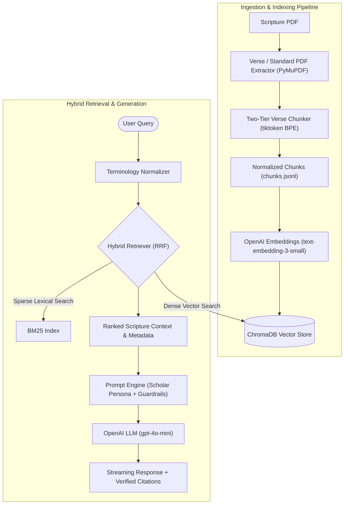

# YogicScholar 🧘

> An intelligent, hybrid Retrieval-Augmented Generation (RAG) system specialized in classical yogic scriptures, featuring verse-level chunking, Sanskrit terminology alignment, verified citation grounding, and an interactive Streamlit UI.

[](https://www.python.org/downloads/)
[](LICENSE)
[](https://streamlit.io/)
[](https://www.trychroma.com/)

---

## Overview

Classical yogic texts like the *Hatha Yoga Pradipika* (by Yogi Svatmarama / Swami Muktibodhananda) contain nuanced Sanskrit verses accompanied by extensive philosophical and practical commentary. Standard document chunking methods often fragment these texts across arbitrary character boundaries, separating Sanskrit slokas from their commentary or severing verse boundaries.

**YogicScholar** solves this through a domain-specific RAG pipeline that preserves scripture hierarchy:
- **Two-Tier Scripture Chunking**: Preserves isolated Sanskrit slokas alongside their English translations and detailed commentary, strictly bounded by character counts and BPE token budgets.
- **Hybrid Retrieval (Dense + Sparse)**: Blends cosine similarity vector search (`text-embedding-3-small` in ChromaDB) and sparse lexical search (BM25) via Reciprocal Rank Fusion (RRF).
- **Domain Terminology Normalization**: Automatically aligns modern or colloquial yogic queries (e.g., "root lock", "alternate nostril breathing", "spinal twist") with canonical Sanskrit transliterations (*Moola Bandha*, *Nadi Shodhana*, *Matsyendrasana*).
- **Citation Guardrails & Verification**: Enforces verifiable academic citation badges `[Chapter X, Verse Y, pp. A-B]` and eliminates hallucinations.
- **Interactive Interfaces**: Provides both a rich Streamlit web interface with collapsible source excerpts and a terminal REPL.

---

## Architecture



---

## Features

- **Hybrid Search with Reciprocal Rank Fusion (RRF)**: Merges dense embeddings with BM25 keyword matching so both exact Sanskrit terms and thematic queries retrieve top-scoring verses.
- **Dual-Ceiling Chunking**: Enforces strict dual caps (e.g., $\le$ 2000 characters and $\le$ 600 BPE tokens using `cl100k_base`), with Sanskrit transliteration diacritic-expansion handling.
- **Conversational Memory**: Follow-up questions with pronouns (e.g., *"What are its benefits?"*) automatically resolve context from prior turns.
- **Verified Source Attribution**: The Streamlit interface displays exact source cards showing chapter title, verse number, page range, and scripture quotes.
- **Config-Driven & Extensible**: Modular YAML configurations allow adding other classical scriptures (*Gheranda Samhita*, *Yoga Sutras*, *Shiva Samhita*) without changing pipeline code.
- **Comprehensive Test Suite**: 70+ unit tests validating token counters, chunk boundaries, metadata hygiene, retrieval, and chat sessions.

---

## Repository Structure

```
.
├── configs/
│   ├── hatha_yoga_pradipika.yaml   # Scripture layout, margins, and chunking config
│   └── example_standard_book.yaml  # Template for standard narrative books
├── src/
│   ├── app.py                      # Streamlit web application
│   ├── chat.py                     # CLI conversational chat assistant & REPL
│   ├── chroma_manager.py           # ChromaDB client & metadata contract validator
│   ├── embed_and_index.py          # Batch vector embedding & idempotent indexing
│   ├── ingestion_pipeline.py       # PDF parsing & two-tier verse chunker
│   ├── prompt_engine.py            # Prompt templates, term alignment & citation parser
│   └── query_db.py                 # Hybrid retriever (ChromaDB + BM25 via RRF)
├── test/                           # Comprehensive unit test suite (70+ tests)
├── .env.example                    # Environment variable template
├── .gitignore                      # Git exclusion rules
├── LICENSE                         # MIT License
├── requirements.txt                # Python package dependencies
└── README.md                       # Project documentation
```

---

## Getting Started

### Prerequisites
- **Python**: 3.10 or higher
- **OpenAI API Key**: Required for embeddings (`text-embedding-3-small`) and generation (`gpt-4o-mini`).

### 1. Clone the Repository
```bash
git clone https://github.com/cbrahme/yogic-text-rag-pipeline.git
cd yogic-text-rag-pipeline
```

### 2. Set Up Virtual Environment
```bash
python3 -m venv venv
source venv/bin/activate
```

### 3. Install Dependencies
```bash
pip install -r requirements.txt
```

### 4. Configure Environment Variables
Copy the template `.env.example` to `.env` and add your OpenAI API key:
```bash
cp .env.example .env
```
Edit `.env`:
```ini
OPENAI_API_KEY=sk-your-actual-openai-api-key-here
```

---

## Ingestion & Indexing Pipeline

If you want to re-ingest a scripture PDF and build the vector database from scratch:

### Step 1: Chunk the PDF Document
Place your source PDF in `docs/` and run the ingestion pipeline:
```bash
python src/ingestion_pipeline.py --config configs/hatha_yoga_pradipika.yaml
```
This produces `chunks.jsonl` with normalized verse-level records.

### Step 2: Index into ChromaDB
Generate dense embeddings and build the persistent vector collection:
```bash
# Dry run to preview chunk statistics and cost without API calls:
python src/embed_and_index.py --config configs/hatha_yoga_pradipika.yaml --dry-run

# Live indexing:
python src/embed_and_index.py --config configs/hatha_yoga_pradipika.yaml --batch-size 100
```

---

## Running the Application

### Option A: Streamlit Web UI (Recommended)
Launch the interactive web application:
```bash
streamlit run src/app.py
```
Open your browser at `http://localhost:8501` to:
- Ask free-form questions or click starter questions in the sidebar.
- Filter retrieval by specific chapters (*Asana*, *Shatkarma & Pranayama*, *Mudra & Bandha*, *Samadhi*).
- Inspect collapsible source attributions and verified verse citations.

### Option B: Terminal CLI Chat
Launch an interactive REPL in the terminal:
```bash
# Interactive chat loop
python src/chat.py

# Single-query execution with source attribution
python src/chat.py --query "What are the rules and precautions for pranayama practice?" --sources
```

CLI commands available inside the chat session:
- `:sources` — Inspect source chunks retrieved for the last query.
- `:clear` — Reset conversation history.
- `:filter <1-4>` — Filter context to a specific chapter (e.g., `:filter 2`).
- `:clearfilter` — Remove chapter restrictions.
- `:exit` or `:quit` — Exit the REPL.

---

## Running Tests

The test suite includes 70+ automated tests covering text extraction, BPE token counting, dual-ceiling chunking, vector indexing, hybrid retrieval, and conversational state:

```bash
python -m unittest discover test
```

---

## Customizing for Other Scriptures

To index a different yogic text:
1. Create a YAML configuration in `configs/` (see `configs/example_standard_book.yaml` for a narrative text template or `configs/hatha_yoga_pradipika.yaml` for a verse-based scripture).
2. Configure margin ratios, chapter boundaries, and chunking strategy (`verse` or `standard`).
3. Run `src/ingestion_pipeline.py` and `src/embed_and_index.py` with your new config.

---

## License

This project is licensed under the [MIT License](LICENSE).
