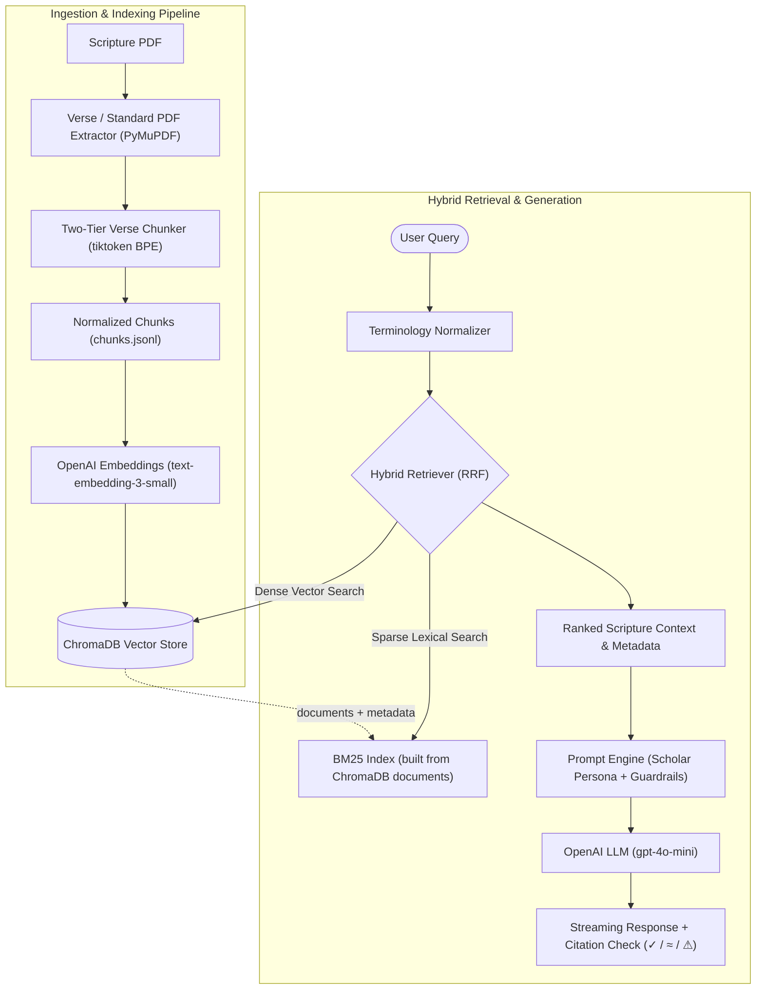

# YogicScholar 🧘

> An intelligent, hybrid Retrieval-Augmented Generation (RAG) system specialized in classical yogic scriptures, featuring verse-level chunking, Sanskrit terminology alignment, verified citation grounding, and an interactive Streamlit UI.

[](https://github.com/cbrahme/yogic-text-rag-pipeline/actions/workflows/tests.yml)
[](https://www.python.org/downloads/)
[](LICENSE)
[](https://streamlit.io/)
[](https://www.trychroma.com/)

---

## Overview

Classical yogic texts like the *Hatha Yoga Pradipika* (by Yogi Svatmarama / Swami Muktibodhananda) contain nuanced Sanskrit verses accompanied by extensive philosophical and practical commentary. Standard document chunking methods often fragment these texts across arbitrary character boundaries, separating Sanskrit slokas from their commentary or severing verse boundaries.

**YogicScholar** solves this through a domain-specific RAG pipeline that preserves scripture hierarchy:
- **Two-Tier Scripture Chunking**: Preserves isolated Sanskrit slokas alongside their English translations and detailed commentary, strictly bounded by character counts and BPE token budgets.
- **Hybrid Retrieval (Dense + Sparse)**: Blends cosine similarity vector search (`text-embedding-3-small` in ChromaDB) and sparse lexical search (BM25) via Reciprocal Rank Fusion (RRF).
- **Domain Terminology Normalization**: Automatically aligns modern or colloquial yogic queries (e.g., "root lock", "alternate nostril breathing", "spinal twist") with canonical Sanskrit transliterations (*Moola Bandha*, *Nadi Shodhana*, *Matsyendrasana*).
- **Citation Guardrails & Verification**: Every excerpt carries a canonical chapter-and-verse citation (e.g. [Chapter 3, Verses 61-63]) that the model must copy exactly, and each citation in an answer is checked against the excerpts actually retrieved (see [Citation checks](#citation-checks)).
- **Interactive Interfaces**: Provides both a rich Streamlit web interface with collapsible source excerpts and a terminal REPL.

---

## Architecture



---

## Features

- **Hybrid Search with Reciprocal Rank Fusion (RRF)**: Merges dense embeddings with BM25 keyword matching so both exact Sanskrit terms and thematic queries retrieve top-scoring verses.
- **Dual-Ceiling Chunking**: Enforces strict dual caps (e.g., $\le$ 2000 characters and $\le$ 600 BPE tokens using `cl100k_base`), with Sanskrit transliteration diacritic-expansion handling.
- **Conversational Memory**: Follow-up questions with pronouns (e.g., *"What are its benefits?"*) automatically resolve context from prior turns.
- **Source Attribution**: The Streamlit interface displays source cards showing chapter title, verse number, page range, and the retrieved scripture text.
- **Graceful Error Handling**: Invalid API keys, exhausted credits, rate limits, timeouts and network failures show a short, actionable message in both the web app and the CLI instead of a stack trace; the failed question is not saved, so it can simply be asked again.
- **Runs From Any Directory**: Config and data paths resolve from the project root, and querying never silently creates an empty index.
- **Config-Driven & Extensible**: Modular YAML configurations allow adding other classical scriptures (*Gheranda Samhita*, *Yoga Sutras*, *Shiva Samhita*) without changing pipeline code.
- **Comprehensive Test Suite**: ~100 unit tests validating token counters, chunk boundaries, metadata hygiene, retrieval, citation checks, error handling and chat sessions, run automatically on GitHub Actions.

---

## Repository Structure

```
.
├── configs/
│   ├── hatha_yoga_pradipika.yaml   # Scripture layout, margins, and chunking config
│   └── example_standard_book.yaml  # Template for standard narrative books
├── src/
│   ├── app.py                      # Streamlit web application
│   ├── chat.py                     # CLI conversational chat assistant & REPL
│   ├── chroma_manager.py           # ChromaDB client & metadata contract validator
│   ├── embed_and_index.py          # Batch vector embedding & idempotent indexing
│   ├── error_messages.py           # User-facing error messages (app + CLI)
│   ├── ingestion_pipeline.py       # PDF parsing & two-tier verse chunker
│   ├── project_paths.py            # Project-root path resolution
│   ├── prompt_engine.py            # Prompt templates, term alignment, citation checks
│   └── query_db.py                 # Hybrid retriever (ChromaDB + BM25 via RRF)
├── eval/                           # Evaluation set (questions.yaml) and runner (run_eval.py)
├── test/                           # Unit test suite
├── .github/workflows/tests.yml     # CI: runs the tests on Python 3.11 and 3.12
├── .env.example                    # Environment variable template
├── .gitignore                      # Git exclusion rules
├── LICENSE                         # MIT License
├── requirements.txt                # Pinned dependencies (direct + transitive)
└── README.md                       # Project documentation
```

---

## Getting Started

### Prerequisites
- **Python**: 3.11 or higher (current Streamlit and pandas no longer support 3.10)
- **OpenAI API Key**: Required for embeddings (`text-embedding-3-small`) and generation (`gpt-4o-mini`).
- **The scripture PDF**: Not included in this repository, because the translation and commentary are copyrighted. Obtain your own copy of the *Hatha Yoga Pradipika* (Bihar School of Yoga edition) and build the index yourself (see below). The generated `chunks.jsonl` and `chroma_db/` contain the book's text, so they are git-ignored and should not be committed.

### 1. Clone the Repository
```bash
git clone https://github.com/cbrahme/yogic-text-rag-pipeline.git
cd yogic-text-rag-pipeline
```

### 2. Set Up Virtual Environment
```bash
python3 -m venv venv
source venv/bin/activate
```

### 3. Install Dependencies
```bash
pip install -r requirements.txt
```

### 4. Configure Environment Variables
Copy the template `.env.example` to `.env` and add your OpenAI API key:
```bash
cp .env.example .env
```
Edit `.env`:
```ini
OPENAI_API_KEY=sk-your-actual-openai-api-key-here
```

---

## Ingestion & Indexing Pipeline

The app needs a local ChromaDB index, which you build once from your own copy of the PDF.

### Step 1: Chunk the PDF Document
Save your PDF as `docs/Hatha-Yoga-Pradipika-pages-2.pdf` (or point `pdf_path` in the config at it) and run the ingestion pipeline:
```bash
python src/ingestion_pipeline.py --config configs/hatha_yoga_pradipika.yaml
```
This produces `chunks.jsonl` with normalized verse-level records.

### Step 2: Index into ChromaDB
Generate dense embeddings and build the persistent vector collection:
```bash
# Dry run to preview chunk statistics and cost without API calls:
python src/embed_and_index.py --config configs/hatha_yoga_pradipika.yaml --dry-run

# Live indexing:
python src/embed_and_index.py --config configs/hatha_yoga_pradipika.yaml --batch-size 100
```
Embedding the whole book (~213k tokens) costs well under one cent. Only `chroma_db/` is needed at runtime; the keyword (BM25) index is rebuilt from it on startup.

---

## Running the Application

### Option A: Streamlit Web UI (Recommended)
Launch the interactive web application:
```bash
streamlit run src/app.py
```
Open your browser at `http://localhost:8501` to:
- Ask free-form questions or click starter questions in the sidebar.
- Filter retrieval by specific chapters (*Asana*, *Shatkarma & Pranayama*, *Mudra & Bandha*, *Samadhi*).
- Inspect collapsible source excerpts and the citation check for each answer.

### Option B: Terminal CLI Chat
Launch an interactive REPL in the terminal:
```bash
# Interactive chat loop
python src/chat.py

# Single-query execution with source attribution
python src/chat.py --query "What are the rules and precautions for pranayama practice?" --sources
```

CLI commands available inside the chat session:
- `:sources` / `:sources full` — Show the excerpts retrieved for the last answer (truncated / full text), with the citation check.
- `:ch <1-4>` — Filter retrieval to one chapter (e.g., `:ch 2`); `:all` removes the filter.
- `:k <N>` — Change how many excerpts are retrieved (default 4).
- `:model <name>` — Switch the OpenAI chat model.
- `:history` — Show past turns; `:clear` resets the conversation.
- `:help` — List commands; `exit` or `quit` leaves the chat.

In `--query` mode the CLI exits with status 1 and a one-line message on errors (bad key, no index, network failure). Set `YOGIC_DEBUG=1` to print full tracebacks.

### Citation checks
Citations use chapter and verse only, such as [Chapter 3, Verses 61-63]. Verse numbering is shared across editions and translations of the *Hatha Yoga Pradipika*, while page numbers belong to one printed edition, so they are left out of answers (source cards in the web app still show them). Each citation in an answer is compared with the excerpts retrieved for that answer:

| Mark | Meaning |
|---|---|
| ✓ | Exactly matches a retrieved excerpt's citation |
| ≈ | Overlaps a retrieved excerpt, but its verse range differs (e.g. "Verse 62" when the excerpt covers Verses 59-65), so the exact verses are not confirmed |
| ⚠ | Matches no retrieved excerpt; treat with caution |

The check confirms a citation points at retrieved text; it does not judge whether the answer's wording is faithful to that text.

---

## Running Tests

The test suite covers text extraction, BPE token counting, dual-ceiling chunking, vector indexing, hybrid retrieval, citation checks, path resolution, error handling, and conversational state:

```bash
python -m unittest discover test
```

Tests also run automatically on GitHub Actions (Python 3.11 and 3.12) for every push to `main` and every pull request. They need no API key, index or PDF: OpenAI calls are mocked and ChromaDB uses temporary directories.

---

## Evaluation

`eval/questions.yaml` holds 34 questions (how-to, benefits, definitions, lists, everyday English wording, a follow-up, advanced practices and off-topic questions). Each one lists the verses a correct answer should come from and a few key facts it must contain. `eval/run_eval.py` runs them through the real pipeline and reports:

| Metric | Meaning |
|---|---|
| Retrieval hit rate | An expected verse was among the retrieved excerpts |
| Answers citing an expected verse | The answer cites at least one expected verse |
| Key-fact recall | Share of key facts present in the answers (checked by an LLM judge, `gpt-4o` by default) |
| Answers with unsupported claims | Answers containing a claim for which the judge could not quote supporting text from the retrieved excerpts (each quote is verified in code, so the judge cannot simply assert support) |
| Citation ✓ / ≈ / ⚠ | Citation check results across all answers |
| Guru warnings, declines | Advanced practices mention a guru; off-topic questions are declined |

```bash
python eval/run_eval.py                                  # full run (about $0.30, mostly the gpt-4o judge)
python eval/run_eval.py --only mitahara-what --no-judge  # quick check without the judge (fractions of a cent)
python eval/run_eval.py --compare eval/results/<earlier>.json   # show changes vs an earlier run
```

It needs your API key and a built index, so it is run manually (not in CI). Results are saved to `eval/results/`, which is git-ignored because it contains the model's answers. LLM output and judging vary a little between runs, so treat small differences as noise.

---

## Customizing for Other Scriptures

To index a different yogic text:
1. Create a YAML configuration in `configs/` (see `configs/example_standard_book.yaml` for a narrative text template or `configs/hatha_yoga_pradipika.yaml` for a verse-based scripture).
2. Configure margin ratios, chapter boundaries, and chunking strategy (`verse` or `standard`).
3. Run `src/ingestion_pipeline.py` and `src/embed_and_index.py` with your new config.

---

## License

This project is licensed under the [MIT License](LICENSE).
